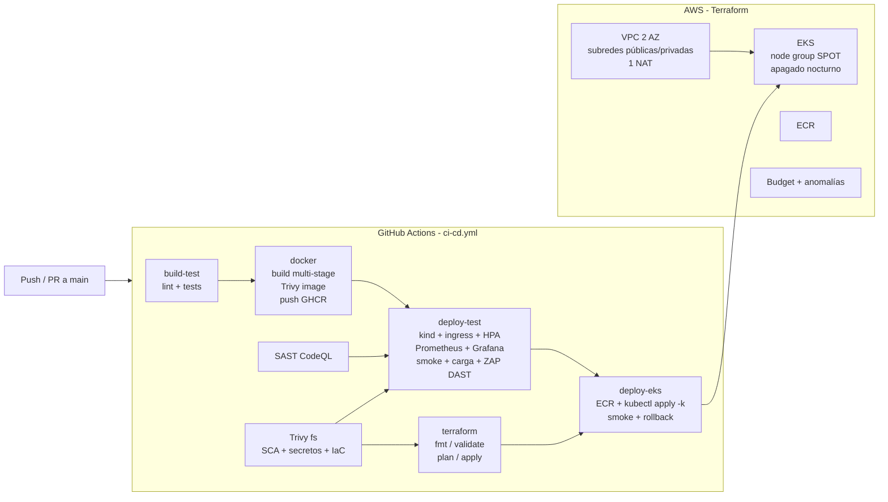

# Proyecto Final DevOps — Pipeline CI/CD completo para `tasks-api`

[](https://github.com/kguttas/devops-pf-tasks-api/actions/workflows/ci-cd.yml)

Pipeline profesional de punta a punta para una API REST en Node.js: **build → test → análisis de
seguridad (SAST/SCA/IaC) → imagen Docker → Terraform → despliegue en Kubernetes con HPA →
monitoreo con Prometheus/Grafana → DAST con OWASP ZAP**, con prácticas de **FinOps** para
controlar el costo.

| Pieza | Tecnología | Dónde |
|---|---|---|
| Aplicación | Node.js 22 + Express 5, estado compartido en Redis, métricas `prom-client` | [`app/`](app/) |
| Contenedor | Dockerfile multi-stage (deps → test → runtime no-root) | [`app/Dockerfile`](app/Dockerfile) |
| IaC | Terraform ≥ 1.10, módulos `network`, `eks`, `finops`, estado remoto S3 | [`terraform/`](terraform/) |
| Orquestación | Kubernetes + Kustomize: Deployment, Service, Ingress, HPA, PDB, NetworkPolicy | [`k8s/`](k8s/) |
| CI/CD | GitHub Actions | [`.github/workflows/`](.github/workflows/) |
| Monitoreo | kube-prometheus-stack (Prometheus, Grafana, Alertmanager), ServiceMonitor, alertas, dashboard | [`monitoring/`](monitoring/) |
| Seguridad | CodeQL (SAST), Trivy (SCA, secretos, IaC, imagen), npm audit, OWASP ZAP (DAST) | pipeline |
| FinOps | Spot, NAT único, apagado nocturno (nodos y Pods), HPA, right-sizing, quotas, budget, Infracost | ver [FinOps](#7-finops-optimización-de-costos) |

---

## Índice

1. [Arquitectura](#1-arquitectura)
2. [Estructura del repositorio](#2-estructura-del-repositorio)
3. [Ejecutar localmente](#3-ejecutar-localmente)
4. [Entorno de pruebas en Kubernetes (kind)](#4-entorno-de-pruebas-en-kubernetes-kind)
5. [Pipeline CI/CD](#5-pipeline-cicd)
6. [Infraestructura con Terraform (AWS EKS)](#6-infraestructura-con-terraform-aws-eks)
7. [FinOps: optimización de costos](#7-finops-optimización-de-costos)
8. [Seguridad (DevSecOps)](#8-seguridad-devsecops)
9. [Cómo validar despliegue y monitoreo](#9-cómo-validar-despliegue-y-monitoreo)
10. [Evidencias](#10-evidencias)
11. [Limpieza](#11-limpieza)

---

## 1. Arquitectura



Dentro del cluster:

```
Internet ─▶ Ingress (ingress-nginx) ─▶ Service tasks-api (ClusterIP) ─▶ Pods tasks-api (2..10, HPA CPU/mem) ─▶ Redis
                                                                         ▲
Prometheus ── ServiceMonitor /metrics ───────────────────────────────────┘
Grafana ◀── Prometheus  (dashboard "tasks-api - Servicio")      Alertmanager ◀── PrometheusRule
```

## 2. Estructura del repositorio

```
.
├── app/                         # API Node.js + tests + Dockerfile multi-stage
│   ├── src/ (app.js, metrics.js, store.js, server.js)
│   ├── test/                    # 12 tests (node:test) + cobertura
│   └── Dockerfile
├── terraform/
│   ├── main.tf, variables.tf, outputs.tf, versions.tf
│   ├── modules/network          # VPC, subredes, IGW, NAT, rutas, flow logs
│   ├── modules/eks              # IAM, cluster EKS (KMS, logs), node group, add-ons
│   ├── modules/finops           # schedule de apagado, budget, detección de anomalías
│   ├── environments/{dev,prod}.tfvars
│   ├── bootstrap/               # bucket S3 del estado remoto (se aplica una vez)
│   └── backend.hcl.example
├── k8s/
│   ├── base/                    # Namespace, Deployment, Service, Ingress, HPA, PDB, NetworkPolicy, Quota, Redis
│   ├── components/off-hours/    # CronJobs FinOps (escala a 0 de noche)
│   ├── overlays/kind/           # entorno de pruebas
│   ├── overlays/eks/            # entorno AWS
│   └── kind-config.yaml
├── monitoring/
│   ├── kube-prometheus-stack-values.yaml
│   ├── k8s/                     # ServiceMonitor, PrometheusRule, dashboard Grafana (ConfigMap)
│   └── local/                   # Prometheus + Grafana para docker compose
├── scripts/                     # kind-up, smoke-test, load-test, collect-evidence (CI y local)
├── .github/workflows/           # ci-cd.yml, infra-destroy.yml
├── .zap/rules.tsv               # reglas de OWASP ZAP
├── docker-compose.yml           # entorno local
└── docs/                        # informe + evidencias
```

## 3. Ejecutar localmente

**Requisitos:** Docker Desktop (o Docker Engine + Compose v2). Opcional: Node.js 22 para correr los tests sin Docker.

```bash
git clone https://github.com/kguttas/devops-pf-tasks-api.git
cd devops-pf-tasks-api

# App + Redis + Prometheus + Grafana
docker compose up -d --build
docker compose ps
```

| Servicio | URL | Credenciales |
|---|---|---|
| API | http://localhost:3000 | — |
| Prometheus | http://localhost:9090 | — |
| Grafana | http://localhost:3001 | `admin` / valor de `GRAFANA_ADMIN_PASSWORD` en `.env` (por defecto `admin`, solo local) |

Sin `REDIS_URL` la app usa un almacén en memoria (tests y ejecución con `npm start`); en compose y Kubernetes usa Redis para que todas las réplicas compartan los datos.

Probar la API:

```bash
curl http://localhost:3000/healthz
curl -X POST -H "content-type: application/json" -d '{"title":"Mi tarea"}' http://localhost:3000/api/tasks
curl http://localhost:3000/api/tasks
curl http://localhost:3000/metrics | grep http_requests_total
```

Tests sin Docker:

```bash
cd app
npm ci
npm run lint
npm test          # node:test + cobertura, genera test-results.xml (JUnit)
```

### Endpoints

| Método | Ruta | Descripción |
|---|---|---|
| GET | `/` | Información del servicio y versión |
| GET | `/healthz` | Liveness |
| GET | `/readyz` | Readiness (503 durante el apagado ordenado o si Redis no responde) |
| GET | `/metrics` | Métricas Prometheus |
| GET/POST | `/api/tasks` | Listar / crear tareas |
| GET/PATCH/DELETE | `/api/tasks/:id` | Ver / marcar hecha / borrar |
| GET | `/api/work?ms=200` | Carga de CPU acotada (≤ 500 ms) para demostrar el HPA |

## 4. Entorno de pruebas en Kubernetes (kind)

El mismo script que usa el pipeline levanta un cluster completo en la máquina local.

**Requisitos:** Docker, [kind](https://kind.sigs.k8s.io/), kubectl, helm, bash (en Windows: Git Bash).

```bash
docker build -t tasks-api:local --build-arg APP_VERSION=local app
IMAGE=tasks-api:local GRAFANA_PASSWORD='elige-una' bash scripts/kind-up.sh
bash scripts/smoke-test.sh                       # contra http://localhost:8080 (ingress)
DURATION=120 bash scripts/load-test.sh           # genera carga y registra el escalado del HPA
bash scripts/collect-evidence.sh                 # guarda evidencias en ./evidence
```

`kind-up.sh` crea el cluster (puertos 8080/8443 → ingress), instala **ingress-nginx**,
**metrics-server**, **kube-prometheus-stack**, aplica el ServiceMonitor, las alertas y el
dashboard, y despliega la app con `kubectl kustomize k8s/overlays/kind`.

Acceso a Grafana y Prometheus del cluster:

```bash
kubectl -n monitoring port-forward svc/monitoring-grafana 3001:80
kubectl -n monitoring port-forward svc/monitoring-prometheus 9090:9090
```

## 5. Pipeline CI/CD

Archivo: [`.github/workflows/ci-cd.yml`](.github/workflows/ci-cd.yml). Se ejecuta en cada push y PR a `main` y manualmente (`workflow_dispatch`).

| # | Job | Qué hace | Falla si… |
|---|---|---|---|
| 1 | `build-test` | `npm ci`, ESLint, 12 tests con cobertura, publica JUnit | lint o tests fallan |
| 2 | `sast-codeql` | CodeQL `security-extended` para JavaScript → pestaña *Security* | — (reporta) |
| 3 | `security-scan` | `npm audit`, Trivy fs: CVEs de dependencias, secretos y misconfiguraciones de Terraform/K8s/Dockerfile (SARIF) | hay hallazgos CRITICAL o vulnerabilidades high en npm |
| 4 | `docker` | Ejecuta la etapa `test` del Dockerfile, construye `runtime`, escanea la imagen con Trivy, la publica en **GHCR** (`sha-<commit>` y `latest`) | CVE CRITICAL corregible en la imagen |
| 5 | `terraform` | `fmt -check`, `validate`; con AWS habilitado: `init` (backend S3), `plan`, Infracost, `apply` en `main` | formato o validación |
| 6 | `deploy-test` | Cluster **kind** efímero: ingress, metrics-server, Prometheus/Grafana, despliegue con Kustomize, smoke tests, prueba de carga (HPA), **OWASP ZAP** baseline + full scan, captura del dashboard, evidencias | smoke tests o alertas ZAP de riesgo alto |
| 7 | `deploy-eks` | Solo en `main` con AWS habilitado y tras aprobar el environment `aws-dev`: push a ECR, ingress + monitoreo con Helm, `kubectl apply -k`, rollout, smoke tests, **rollback automático** si falla | rollout o smoke tests |

Paralelización: `build-test`, `sast-codeql` y `security-scan` corren en paralelo; `docker` y `terraform` también. Estrategia de despliegue: **rolling update** con `maxUnavailable: 0`, probes de readiness y PDB → sin downtime.

Otros workflows:
- [`infra-destroy.yml`](.github/workflows/infra-destroy.yml): destruye el entorno AWS bajo demanda (FinOps).
- [`dependabot.yml`](.github/dependabot.yml): actualizaciones semanales de npm, imagen base, actions y providers.

### Variables y secretos del repositorio

Ninguna credencial está en el código. Se configuran en *Settings → Secrets and variables → Actions*:

| Tipo | Nombre | Uso | Obligatorio |
|---|---|---|---|
| Secret | `GITHUB_TOKEN` | Push a GHCR (automático) | automático |
| Secret | `GRAFANA_ADMIN_PASSWORD` | Contraseña admin de Grafana | recomendado |
| Variable | `AWS_ENABLED` | `true` activa plan/apply y deploy en EKS | solo AWS |
| Secret | `AWS_ROLE_ARN` | Rol IAM asumido por **OIDC** (sin access keys) | solo AWS |
| Variable | `AWS_REGION` | Región (por defecto `us-east-1`) | opcional |
| Variable | `TF_STATE_BUCKET` | Bucket S3 del estado remoto | solo AWS |
| Secret | `INFRACOST_API_KEY` | Estimación de costo del plan | opcional |

Sin la parte AWS el pipeline igualmente ejecuta **build → test → SAST → imagen → validate → despliegue en Kubernetes (kind) → DAST** completo.

## 6. Infraestructura con Terraform (AWS EKS)

```
terraform/
├── main.tf          -> módulos network + eks + finops, ECR con lifecycle
├── variables.tf     -> todas las opciones parametrizadas y validadas
└── environments/    -> dev.tfvars (barato) / prod.tfvars (alta disponibilidad)
```

Recursos: VPC con subredes públicas/privadas en 2 AZ, IGW, NAT, flow logs; EKS (secrets cifrados con KMS, logs de auditoría, API con CIDRs restringibles, autenticación por *access entries*); managed node group en subredes privadas; add-ons `vpc-cni`, `kube-proxy`, `coredns`, `metrics-server`; ECR con escaneo al push y tags inmutables; budget y detección de anomalías de costo.

Pasos manuales (una vez):

```bash
# 1. Bucket del estado remoto
cd terraform/bootstrap
terraform init && terraform apply -var="bucket_name=tasks-api-tfstate-<sufijo>"

# 2. Infraestructura
cd ..
cp backend.hcl.example backend.hcl        # editar bucket
terraform init -backend-config=backend.hcl
terraform plan  -var-file=environments/dev.tfvars -out=tfplan
terraform apply tfplan
aws eks update-kubeconfig --region us-east-1 --name tasks-api-dev
```

Para que el pipeline lo haga solo: crear un rol IAM con *trust policy* para el proveedor OIDC `token.actions.githubusercontent.com` restringido a este repositorio, y definir `AWS_ENABLED=true`, `AWS_ROLE_ARN` y `TF_STATE_BUCKET`.

## 7. FinOps: optimización de costos

| Estrategia | Implementación | Ahorro aproximado |
|---|---|---|
| Instancias Spot | `node_capacity_type = "SPOT"` con 2 tipos de instancia (dev) | hasta ~70 % en cómputo |
| Apagado de nodos fuera de horario | `aws_autoscaling_schedule` escala el node group a 0 a las 20:00 y lo sube a las 08:00 (lun-vie) | ~64 % de las horas de nodo |
| Apagado de Pods fuera de horario | CronJobs `scale-down-night` / `scale-up-morning` ([`off-hours`](k8s/components/off-hours/off-hours.yaml)) | libera capacidad para que el autoscaler reduzca nodos |
| Auto-escalado | HPA 2→10 Pods por CPU/memoria, bajada gradual sin dejar Pods ociosos | paga solo por la demanda |
| NAT Gateway único | `single_nat_gateway = true` en dev | ~32 USD/mes por AZ evitada |
| Right-sizing | requests 50m/64Mi medidos con Prometheus; alerta `TasksApiCpuOverProvisioned` y panel "CPU solicitada vs usada" | evita reservar CPU que no se usa |
| Techos de gasto | `ResourceQuota`, `LimitRange`, `node_max_size`, `maxReplicas` | acota el peor caso |
| Retención corta | logs de EKS y flow logs 7 días, Prometheus 3 días, versiones del estado 30 días, ECR borra imágenes sin tag a los 7 días | almacenamiento |
| Visibilidad | etiquetas `Project/Environment/Owner/CostCenter` en todo (`default_tags`), `aws_budgets_budget` con alertas 80 %/100 %, detección de anomalías, Infracost en el plan | showback y alertas tempranas |
| Entornos efímeros | las pruebas de integración y DAST corren en **kind** dentro del runner (costo 0) y `infra-destroy.yml` elimina AWS cuando no se usa | sin entornos de prueba encendidos |

Estimación del entorno dev encendido 24/7 vs. con FinOps (us-east-1, precios de lista aproximados):

| Componente | 24/7 on-demand | Con FinOps |
|---|---|---|
| Control plane EKS | 73 USD | 73 USD |
| 2 × t3.medium | 61 USD | ~8 USD (Spot + 36 % de las horas) |
| NAT Gateway | 65 USD (2 AZ) | 33 USD (1 NAT) |
| **Total** | **~199 USD/mes** | **~114 USD/mes (-43 %)** |

## 8. Seguridad (DevSecOps)

- **SAST**: CodeQL (`security-extended`) y Trivy misconfig sobre Terraform, manifiestos y Dockerfile; resultados en la pestaña *Security → Code scanning* (SARIF).
- **SCA**: `npm audit` + Trivy sobre `package-lock.json` y sobre la imagen final. Dependabot semanal.
- **Secretos**: Trivy secret scanning; credenciales solo como *GitHub Secrets*; AWS por **OIDC** (sin claves de larga duración).
- **DAST**: OWASP ZAP *baseline* (pasivo) y *full scan* (activo) contra la app desplegada en el cluster de pruebas; el pipeline falla con alertas de riesgo alto. Reglas en [`.zap/rules.tsv`](.zap/rules.tsv).
- **Imagen**: multi-stage, `node:22-alpine`, sin npm/yarn en runtime, usuario `node` (no root), `HEALTHCHECK`.
- **Kubernetes**: Pod Security `restricted`, `runAsNonRoot`, `readOnlyRootFilesystem`, `drop ALL`, seccomp, ServiceAccount sin token, NetworkPolicy (solo ingress y monitoring), límite de RPS en el ingress.
- **App**: `helmet` (cabeceras), límite de body 10 kB, validación de entrada, apagado ordenado con SIGTERM.
- **AWS**: secrets de EKS con KMS, logs de auditoría, subredes privadas para nodos, SG por defecto cerrado, flow logs, ECR inmutable con scan-on-push, estado cifrado y privado.

Excepciones aceptadas y justificadas: [`.trivyignore`](.trivyignore).

## 9. Cómo validar despliegue y monitoreo

**Despliegue**

```bash
kubectl -n tasks-api get deploy,pods,svc,ingress,hpa
kubectl -n tasks-api rollout status deployment/tasks-api
bash scripts/smoke-test.sh                       # BASE_URL=http://<lb> para EKS
```

**Auto-escalado**

```bash
DURATION=120 bash scripts/load-test.sh
kubectl -n tasks-api get hpa tasks-api -w        # TARGETS sube sobre 60 % y REPLICAS de 2 hacia 5
```

**Monitoreo**

1. Prometheus → *Status → Targets*: el job `tasks-api` debe estar **UP** (una entrada por Pod).
2. Consultas útiles:
   - `sum by (route,status) (rate(http_requests_total{job="tasks-api"}[1m]))`
   - `histogram_quantile(0.95, sum by (le) (rate(http_request_duration_seconds_bucket{job="tasks-api"}[5m])))`
   - `kube_horizontalpodautoscaler_status_current_replicas{horizontalpodautoscaler="tasks-api"}`
3. Prometheus → *Alerts*: reglas `TasksApiDown`, `TasksApiHighErrorRate`, `TasksApiHighLatencyP95`, `TasksApiHpaAtMax`, `TasksApiCpuOverProvisioned`.
4. Grafana → dashboard **"tasks-api - Servicio"**: peticiones/s, % errores, latencia p50/p95/p99, réplicas del HPA, CPU/memoria por Pod, CPU solicitada vs usada (FinOps).

**En el pipeline**: cada ejecución publica el artefacto `evidence-deploy-test` con el estado del cluster, la evolución del HPA, consultas a Prometheus, logs, la captura del dashboard y los reportes de ZAP.

## 10. Evidencias

Ver [`docs/evidencias/`](docs/evidencias/) y el informe [`docs/INFORME.md`](docs/INFORME.md) (versión PDF de entrega: [`docs/PFEstrada.pdf`](docs/PFEstrada.pdf)).

| Evidencia | Archivo |
|---|---|
| Ejecución del pipeline en GitHub Actions (todos los jobs en verde) | [`docs/evidencias/pipeline-run.png`](docs/evidencias/pipeline-run.png) y pestaña [Actions](https://github.com/kguttas/devops-pf-tasks-api/actions) |
| Evidencias generadas por el propio pipeline (HPA, smoke, Prometheus, ZAP, Trivy, tests) | [`docs/evidencias/ci/`](docs/evidencias/ci/) |
| Tests unitarios y cobertura | [`docs/evidencias/tests.txt`](docs/evidencias/tests.txt) |
| Recursos de Kubernetes desplegados | [`docs/evidencias/k8s-resources.txt`](docs/evidencias/k8s-resources.txt) |
| Escalado del HPA bajo carga | [`docs/evidencias/hpa-scaling.log`](docs/evidencias/hpa-scaling.log) |
| Targets y consultas de Prometheus | [`docs/evidencias/prometheus-queries.txt`](docs/evidencias/prometheus-queries.txt) |
| Dashboard de Grafana | [`docs/evidencias/grafana-dashboard.png`](docs/evidencias/grafana-dashboard.png) |
| Targets y alertas en Prometheus | [`prometheus-targets.png`](docs/evidencias/prometheus-targets.png), [`prometheus-alerts.png`](docs/evidencias/prometheus-alerts.png) |
| Smoke tests vía Ingress | [`docs/evidencias/smoke-test.log`](docs/evidencias/smoke-test.log) |
| Reporte OWASP ZAP (DAST) | [`docs/evidencias/zap-report.md`](docs/evidencias/zap-report.md), [`zap-baseline.log`](docs/evidencias/zap-baseline.log) |
| Escaneo Trivy del repositorio (IaC, secretos, dependencias) | [`docs/evidencias/trivy-fs.txt`](docs/evidencias/trivy-fs.txt) |
| Terraform fmt + validate | [`docs/evidencias/terraform-validate.txt`](docs/evidencias/terraform-validate.txt) |
| Grafana local (docker compose) | [`docs/evidencias/grafana-local-compose.png`](docs/evidencias/grafana-local-compose.png) |
| Escaneo Trivy de la imagen | [`docs/evidencias/trivy-image.txt`](docs/evidencias/trivy-image.txt) |

## 11. Limpieza

```bash
docker compose down -v                  # entorno local
kind delete cluster --name tasks-api    # entorno de pruebas
# AWS: Actions → "Destroy infra" → confirmar con "destroy"  (o terraform destroy -var-file=environments/dev.tfvars)
```
