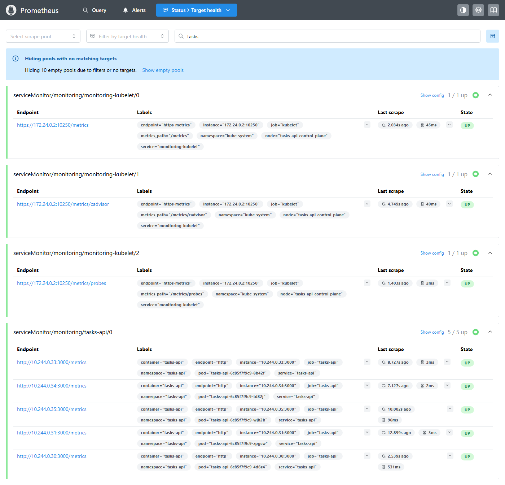
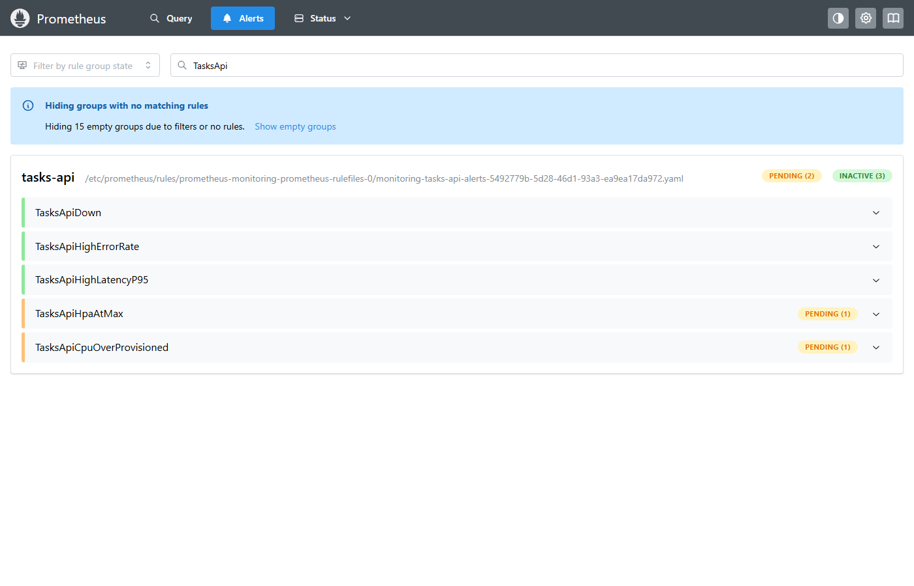
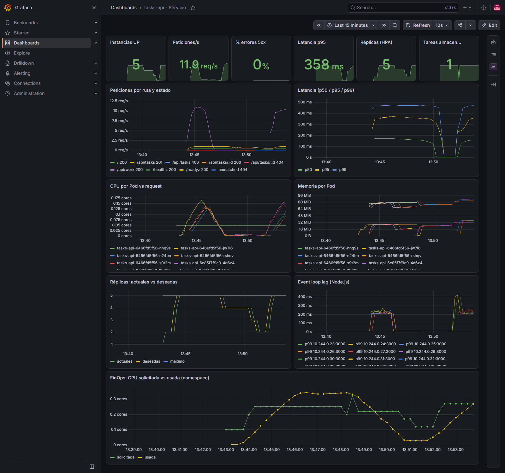

# Proyecto Final DevOps — Informe

**Pipeline CI/CD completo con Docker, Terraform, Kubernetes, monitoreo, DevSecOps y FinOps**

- Repositorio: https://github.com/kguttas/devops-pf-tasks-api
- Pipeline: https://github.com/kguttas/devops-pf-tasks-api/actions/workflows/ci-cd.yml
- Fecha: noviembre de 2026

---

## 1. Resumen

Se construyó un pipeline automatizado que lleva una API REST (`tasks-api`, Node.js 22) desde el
código hasta un cluster Kubernetes, con análisis de seguridad, monitoreo y control de costos:

1. **Build y test**: lint (ESLint) y 12 tests con cobertura (~97 % de líneas).
2. **Seguridad estática**: CodeQL (SAST), Trivy (dependencias, secretos y misconfiguraciones de
   Terraform/Kubernetes/Dockerfile), `npm audit`.
3. **Imagen Docker** multi-stage (65,8 MB), escaneada con Trivy y publicada en GitHub Container Registry.
4. **Infraestructura como código** con Terraform: VPC, EKS, ECR, presupuesto y apagado programado,
   organizada en módulos y parametrizada con variables.
5. **Despliegue en Kubernetes** con Kustomize: Deployment, Service, Ingress, HPA, PDB, NetworkPolicy, ResourceQuota.
6. **Entorno de pruebas efímero** (kind) en cada ejecución, con Prometheus y Grafana, smoke tests,
   prueba de carga que dispara el HPA y **DAST** con OWASP ZAP.
7. **Despliegue en AWS EKS** (habilitable con variables) con aprobación manual y rollback automático.
8. **FinOps**: Spot, NAT único, apagado nocturno de nodos y Pods, HPA, right-sizing, quotas,
   retenciones cortas, etiquetas de costo, budget y detección de anomalías.

## 2. Pasos realizados

### 2.1 Repositorio

- Repositorio en GitHub con rama `main`, commits pequeños y descriptivos (Conventional Commits:
  `feat:`, `ci:`, `docs:`…), `.gitignore` que excluye estado de Terraform, `.env` y credenciales.
- Dependabot configurado para npm, imagen base, GitHub Actions y providers de Terraform.

### 2.2 Aplicación

API de tareas con Express 5 y estado compartido en Redis (necesario porque el HPA crea varias réplicas): CRUD en `/api/tasks`, `/healthz` (liveness), `/readyz` (readiness, devuelve
503 durante el apagado), `/metrics` (Prometheus: `http_requests_total`, `http_request_duration_seconds`,
`tasks_total` y métricas del runtime) y `/api/work` (carga de CPU acotada para demostrar el auto-escalado).
Incluye `helmet`, límite de tamaño de body, validación de entrada y apagado ordenado ante `SIGTERM`.

### 2.3 Docker (multi-stage)

[`app/Dockerfile`](../app/Dockerfile) con tres etapas:

| Etapa | Contenido | Propósito |
|---|---|---|
| `deps` | `npm ci --omit=dev` con caché de BuildKit | dependencias de producción en una capa cacheable |
| `test` | devDependencies + `npm run lint && npm test` | el build falla si fallan los tests |
| `runtime` | `node:22-alpine`, solo `node_modules` de producción y `src/`, sin npm/yarn/corepack, usuario `node`, `HEALTHCHECK` | imagen mínima y segura |

Resultado: imagen de **65,8 MB** (contenido comprimido) frente a ~1,1 GB de una imagen `node:22` sin optimizar.

### 2.4 Terraform

Estructura en [`terraform/`](../terraform/):

- `modules/network`: VPC `10.20.0.0/16`, subredes públicas y privadas en 2 AZ etiquetadas para los load
  balancers de Kubernetes, Internet Gateway, NAT (uno o uno por AZ según variable), tablas de rutas,
  security group por defecto cerrado y flow logs.
- `modules/eks`: roles IAM, cluster EKS con secrets cifrados en KMS, logs de auditoría, *access entries*,
  managed node group en subredes privadas y add-ons gestionados (`vpc-cni`, `kube-proxy`, `coredns`, `metrics-server`).
- `modules/finops`: `aws_autoscaling_schedule` (apagado 20:00 / encendido 08:00), `aws_budgets_budget`
  filtrado por etiqueta y `aws_ce_anomaly_monitor`.
- Raíz: ECR con tags inmutables, scan-on-push y lifecycle; `default_tags` para el showback.
- Variables con validaciones y archivos `environments/dev.tfvars` / `prod.tfvars`.
- Estado remoto en S3 con bloqueo nativo (`use_lockfile`), bucket creado por `terraform/bootstrap`
  (versionado, cifrado, acceso público bloqueado).

Validación: `terraform fmt -check` y `terraform validate` pasan en el pipeline y localmente (Terraform 1.17.2).

### 2.5 Kubernetes

[`k8s/base`](../k8s/base/) + overlays `kind` (pruebas) y `eks` (AWS):

- **Deployment**: rolling update `maxSurge 1 / maxUnavailable 0`, startup/liveness/readiness probes,
  requests/limits, `securityContext` restringido, `topologySpreadConstraints`, anotaciones de scraping.
- **Service** ClusterIP e **Ingress** (ingress-nginx) con límite de peticiones por IP.
- **HPA** `autoscaling/v2`: 2–10 réplicas por CPU (60 %) y memoria (80 %), subida rápida y bajada gradual.
- **Redis** (1 réplica, emptyDir, NetworkPolicy que solo admite a la app).
- **PodDisruptionBudget**, **NetworkPolicy**, **ResourceQuota**, **LimitRange**, Namespace con Pod Security `restricted`.
- Componente **off-hours**: CronJobs con RBAC mínimo que escalan la app a 0 de noche y a 2 en la mañana.

### 2.6 Pipeline CI/CD (GitHub Actions)

[`.github/workflows/ci-cd.yml`](../.github/workflows/ci-cd.yml):

```
build-test ─┐
sast-codeql ├─▶ docker (test stage, build, Trivy, push GHCR) ─┐
security-scan ┬───────────────────────────────────────────────┼─▶ deploy-test (kind + monitoreo + smoke + carga + ZAP)
              └─▶ terraform (fmt, validate, plan, apply) ─────┴─▶ deploy-eks (ECR, apply -k, smoke, rollback)
```

- Disparadores: push y PR a `main`, ejecución manual.
- Credenciales: `GITHUB_TOKEN` para GHCR, OIDC para AWS, `GRAFANA_ADMIN_PASSWORD` como secreto.
- `deploy-eks` requiere el environment `aws-dev` (aprobación manual) y solo corre si `AWS_ENABLED=true`.
- `infra-destroy.yml`: destrucción manual del entorno AWS.

### 2.7 Monitoreo

- **kube-prometheus-stack** (Prometheus Operator, Prometheus, Alertmanager, Grafana, kube-state-metrics,
  node-exporter) con perfil liviano ([values](../monitoring/kube-prometheus-stack-values.yaml)).
- **ServiceMonitor** para `tasks-api` y **PrometheusRule** con 5 alertas (caída, errores 5xx,
  latencia p95, HPA al máximo y sobreaprovisionamiento de CPU).
- **Dashboard de Grafana** cargado automáticamente vía ConfigMap (sidecar) con 13 paneles.
- En local, `docker compose` levanta el mismo dashboard con Prometheus y Grafana provisionados.

### 2.8 DevSecOps

| Tipo | Herramienta | Momento |
|---|---|---|
| SAST | CodeQL `security-extended` | cada push/PR |
| SAST IaC | Trivy misconfig (Terraform, K8s, Dockerfile) | cada push/PR |
| SCA | `npm audit`, Trivy (lockfile e imagen), Dependabot | cada push/PR y semanal |
| Secretos | Trivy secret scanning | cada push/PR |
| DAST | OWASP ZAP baseline + full scan contra la app desplegada | cada push/PR |

Los resultados SARIF se publican en *Security → Code scanning*; los reportes HTML/JSON/MD como artefactos.

### 2.9 FinOps

Ver la tabla completa en el [README](../README.md#7-finops-optimización-de-costos). Resumen de la
estimación para el entorno dev: **~199 USD/mes** encendido 24/7 on-demand frente a **~114 USD/mes**
con Spot, NAT único y apagado fuera de horario (**-43 %**). Las pruebas de integración y DAST corren en un
cluster kind efímero dentro del runner, sin costo de nube.

## 3. Evidencias

> Las evidencias se generan automáticamente en cada ejecución del pipeline (artefacto
> `evidence-deploy-test`) y una copia está en [`docs/evidencias/`](evidencias/).

### 3.1 Tests unitarios

12 tests, 0 fallos, cobertura de líneas ~97 % ([tests.txt](evidencias/tests.txt)).

### 3.2 Imagen Docker y escaneo

`tasks-api:local` — 65,8 MB de contenido ([image-size.txt](evidencias/image-size.txt)). Trivy: **0
vulnerabilidades HIGH/CRITICAL** en el sistema base (Alpine) ni en las dependencias ([trivy-image.txt](evidencias/trivy-image.txt)).
Escaneo del repositorio (Terraform, manifiestos, Dockerfile, secretos): sin hallazgos fuera de las
excepciones justificadas en `.trivyignore` ([trivy-fs.txt](evidencias/trivy-fs.txt)).

### 3.3 Despliegue en Kubernetes (entorno de pruebas kind)

Recursos desplegados ([k8s-resources.txt](evidencias/k8s-resources.txt)): Deployment `tasks-api`,
Redis, Services, Ingress, HPA, PDB, NetworkPolicies, ResourceQuota y CronJobs FinOps. Smoke tests a
través del Ingress ([smoke-test.log](evidencias/smoke-test.log)):

```
Smoke tests contra http://localhost:8080
{"name":"tasks-api","version":"local","endpoints":["/api/tasks","/healthz","/readyz","/metrics"]}
OK: todas las pruebas de humo pasaron
```

### 3.4 Auto-escalado (HPA)

Prueba de carga de 150 s contra `/api/work` ([hpa-scaling.log](evidencias/hpa-scaling.log)):

```
16:51:40  cpu: 12%/60%    réplicas 2
16:52:11  cpu: 432%/60%   réplicas 2
16:52:27  cpu: 439%/60%   réplicas 4
16:52:42  cpu: 348%/60%   réplicas 5   (máximo del overlay de pruebas)
Réplicas máximas observadas: 5
```

Al terminar la carga el HPA vuelve gradualmente a 2 réplicas (bajada de 1 Pod cada 30 s).

### 3.5 Monitoreo

Prometheus descubre las 5 réplicas a través del ServiceMonitor (todas **UP**) y carga las 5 reglas de alerta:





Dashboard de Grafana durante la prueba de carga (5 instancias, 11,9 req/s, 0 % de errores, réplicas 2→5):



Consultas PromQL ejecutadas por el pipeline: [prometheus-queries.txt](evidencias/prometheus-queries.txt).

### 3.6 DAST (OWASP ZAP)

Baseline contra la app desplegada detrás del Ingress ([zap-baseline.log](evidencias/zap-baseline.log),
[reporte](evidencias/zap-report.md)):

```
FAIL-NEW: 0  FAIL-INPROG: 0  WARN-NEW: 0  WARN-INPROG: 0  INFO: 0  IGNORE: 1  PASS: 67
```

### 3.7 Terraform

`terraform fmt -check` y `terraform validate` sin errores ([terraform-validate.txt](evidencias/terraform-validate.txt)).

### 3.8 Pipeline en GitHub Actions

Cada ejecución en https://github.com/kguttas/devops-pf-tasks-api/actions deja los artefactos
`test-results`, `trivy-fs-report`, `trivy-image-report`, `docker-image` y `evidence-deploy-test`
(estado del cluster, evolución del HPA, consultas a Prometheus, captura de Grafana y reportes de ZAP).

## 4. Cómo replicar

Seguir el [README](../README.md): secciones 3 (local), 4 (kind), 5 (pipeline) y 6 (AWS).

## 5. Conclusiones

El pipeline automatiza el ciclo completo con controles de calidad y seguridad en cada etapa: nada llega
al cluster sin pasar lint, tests, SAST, escaneo de imagen, pruebas de humo y DAST en un entorno real de
Kubernetes. La infraestructura es reproducible y parametrizada, y las decisiones de costo (Spot, apagado
programado, auto-escalado, retenciones cortas y entornos efímeros) reducen el gasto estimado del
entorno de pruebas en más de 40 % sin afectar las entregas.
